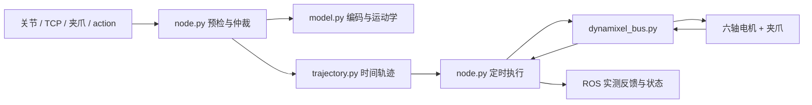

# 六轴机械臂带末端执行器：代码阅读说明

## 1. 从哪里开始

工作空间只保留一个 ROS 2 Python 包：`src/arm6_ros2`。
运行时有六个旋转关节和一个独立夹爪电机，共七个电机。
夹爪开合不计入机械臂的六个旋转自由度。

建议按以下顺序阅读：

1. `config/arm6.yaml`：先了解电机、零位、限位、DH 和工具参数。
2. `arm6_ros2/config.py`：了解参数默认值和 YAML 加载规则。
3. `arm6_ros2/model.py`：了解编码刻度、关节角和 TCP 位姿之间的关系。
4. `arm6_ros2/trajectory.py`：了解目标如何变成满足速度与加速度限制的轨迹。
5. `arm6_ros2/dynamixel_bus.py`：了解程序如何读写七个实际电机。
6. `arm6_ros2/node.py`：将上述模块串起来，查看 ROS 接口、控制循环与状态变化。
7. `launch/arm6.launch.py`、`setup.py`、`package.xml`：了解程序如何安装与启动。
8. `test/`：通过边界情况理解控制器的预期行为。

下面所有包内路径均以 `src/arm6_ros2/` 为起点。

## 2. 文件总览

```text
src/arm6_ros2/
├── arm6_ros2/
│   ├── __init__.py
│   ├── config.py
│   ├── model.py
│   ├── trajectory.py
│   ├── dynamixel_bus.py
│   ├── desktop_control.py
│   ├── encoder_calibration.py
│   ├── forward_line_test.py
│   ├── gamepad_monitor.py
│   ├── gamepad_control.py
│   └── node.py
├── config/
│   ├── arm6.yaml
│   └── arm6_calibration.yaml
├── launch/arm6.launch.py
├── resource/arm6_ros2
├── test/
│   ├── test_arm6_model.py
│   ├── test_arm6_node.py
│   └── test_dynamixel_bus.py
├── setup.py
├── setup.cfg
├── package.xml
├── README.md
└── LICENSE
```

| 文件 | 用途 |
| --- | --- |
| `arm6_ros2/__init__.py` | 声明 Python 包，没有运行控制逻辑 |
| `arm6_ros2/config.py` | 定义参数默认值，加载和检查 YAML 参数名称 |
| `arm6_ros2/model.py` | 编码映射、Craig 改进 DH 正运动学、雅可比、姿态运算、逆运动学和 TCP 路径采样 |
| `arm6_ros2/trajectory.py` | 校验关节轨迹请求，生成并采样五次插值轨迹 |
| `arm6_ros2/dynamixel_bus.py` | 实际串口、Protocol 2.0、同步读写、保持使能、卸力与硬件错误读取 |
| `arm6_ros2/node.py` | ROS 主节点，接收命令、仲裁运动、执行轨迹、发布反馈、处理故障 |
| `arm6_ros2/encoder_calibration.py` | 实机单轴点动面板；用户观察方向、对齐 CAD 后记录实际零位，不自动确认或执行 Cartesian 运动 |
| `arm6_ros2/desktop_control.py` | 用户原点电脑控制面板；鼠标/键盘单轴点动、夹爪、回原点、停止及扭矩操作，不要求 CAD 姿态 |
| `arm6_ros2/gamepad_monitor.py` | 只读采集 F710 实际 /joy 轴/按钮编号，按操作步骤保存映射，不含机械臂命令接口 |
| `arm6_ros2/gamepad_control.py` | 读取实测手柄映射，LB 按住运行、选轴、单轴/夹爪小步控制和超时停止；不自动使能电机 |
| `arm6_ros2/forward_line_test.py` | 实机 10 cm 水平直线客户端，使用在线参数并检查整段路径 |
| `config/arm6.yaml` | 默认硬件和控制参数，包含 CAD 参考映射 |
| `config/arm6_calibration.yaml` | 实机标定试验参数，包含实物参考映射 |
| `launch/arm6.launch.py` | 加载配置并启动唯一的实机控制节点 |
| `setup.py` | 安装 Python 模块、配置与启动文件，注册 `arm6_node` 可执行命令 |
| `setup.cfg` | 指定 ROS 可执行文件安装目录，并配置 pytest |
| `package.xml` | 声明 ROS 包名、版本、依赖和 ament_python 构建方式 |
| `resource/arm6_ros2` | 空的 ament 索引标记，让 ROS 能发现这个包 |
| `test/test_arm6_model.py` | 数学、标定、逆解、轨迹约束回归测试 |
| `test/test_arm6_node.py` | 注入假总线，验证最终实机节点的命令、状态、故障与互斥逻辑 |
| `test/test_dynamixel_bus.py` | 使用假 SDK 验证实际通信层的使能顺序、回读、失败回滚与七电机行为 |
| `README.md` | 安装、参数、接口和操作命令说明 |
| `LICENSE` | 包内 Apache-2.0 许可证 |

## 3. config.py 与 arm6.yaml：所有假设在哪里

`config.py` 的 `DEFAULTS` 是节点声明参数时的默认值；`config/arm6.yaml` 是正式配置入口。
两者的默认内容由测试检查一致。修改项目默认参数时应同步修改两处；
只给某台设备配置时，可复制一份外部 YAML，通过 launch 的 `config` 参数加载。

`load_parameters()` 按 `/**`、`arm6`、`/arm6` 的顺序合并参数，后者覆盖前者，
并拒绝未知参数，防止拼错名称或误用已删除的配置项。
launch 再用启动参数覆盖串口路径与波特率。

数组长度的含义：

| 数组 | 长度 | 顺序 |
| --- | --- | --- |
| `motor_ids`、`expected_model_numbers` | 7 | J1–J6，最后为夹爪 |
| `zero_ticks`、`joint_directions`、位置限位 | 6 | 只包含旋转关节 |
| 四列 DH 参数 | 每列 6 | J1–J6；每行 a_(i-1)、d_i、alpha_(i-1)、角偏置 |
| 关节速度、加速度限制 | 每列 6 | J1–J6 |
| TCP 平移、RPY | 每组 3 | x/y/z 和 roll/pitch/yaw |

夹爪使用独立的闭合刻度、张开刻度和最大开口参数，不把夹爪假装成第七个旋转关节。
`calibration_confirmed` 约束普通运动，`geometry_confirmed` 额外约束 TCP 位姿运动。
这两个标志不会让初始使能自动返回原点。

前三轴实测数据及其来源见 [硬件参数说明](docs/hardware/README.md)。
配置中的 `arm6_cad` 对应总装 CAD 基座坐标系，六轴编码零位和方向仍需与 CAD 定义对齐。

## 4. model.py：编码、关节和末端之间怎么转换

这个文件不依赖 ROS，也不打开串口。

### 输入输出与单位

`ArmModel.decode(ticks)` 将七电机刻度转换成七元素状态：
前六项是关节角 rad，最后一项是夹爪完整开口 m。

`ArmModel.encode(state)` 做相反转换，同时拒绝非有限值、关节越限或夹爪越限。
方向由 `joint_directions` 决定；单圈编码每圈 4096 刻度。
ID11 / J6 是 0–4095 tick 的有限关节；目标和轨迹差值不做角度取模，
从上边界回到下边界时沿区间反向运动，不穿过零点累计同向旋转。
夹爪的开口和端点刻度作线性映射，支持张开刻度小于闭合刻度的安装方向。
当前 `gripper_wraps_zero=true`，闭合 3180，张开单圈值 280 提升为连续值 4376。
这一 1196 tick 短弧使用 Mode 4；六轴仍是 Mode 3，尤其 ID11 不作跨零点处理。

### 正运动学

`mdh_transform()` 构造单行 Craig 改进 DH 变换：

```text
Rx(alpha_prev) × Tx(a_prev) × Rz(q+offset) × Tz(d)
```

`chain(joints)` 返回基座及六个改进 DH 坐标系的累积变换，第 i 帧的 z_i 为关节 i 转轴。
`forward(joints)` 在第六轴变换后乘上固定工具变换，返回基座到 TCP 的 4×4 位姿矩阵。
它的平移部分是 m，旋转部分是 3×3 正交矩阵。

当前 DH 由提供的 SolidWorks 总装标准表等价转换，`q=0` 为保存姿态，正方向按舵机局部 +Z。
改进表的 a、alpha 取原标准表上一行，首行为零；d 和角偏置保持原关节顺序。
原标准表末行 a6、alpha6 均为零，因此转换后末端参考系与原来一致。
第六轴参考点为夹爪转接件 CAD 原点，距腕心 73.5 mm 已包含在 `d6`；
工具变换从该原点起算，默认单位变换，待标定实际抓取点。

### 姿态与逆运动学

`pose_matrix()` 把位置和 ROS 四元数转换成矩阵，并检查四元数归一化。
`quaternion_from_matrix()` 生成反馈四元数，顺序为 x/y/z/w。
`rotation_vector()` 和 `rotation_exp()` 在旋转矩阵与旋转向量之间转换，包含接近 π 的处理。

`jacobian()` 按改进 DH 的 z_i 轴计算 TCP 几何雅可比，取 `chain[1:]` 的轴线和原点。
`inverse(target, seed)` 使用带阻尼的迭代求解，结合步长限制、误差下降检查和关节限位。
种子通常取当前实测关节角，避免任意切换逆解分支；不能从该种子得到连续限位内解时抛出错误。

`cartesian_path(seed, target)` 对 TCP 位置作直线采样，对姿态作最短旋转插值，
依次求逆解并检查相邻关节跳变。它先完整预检，成功才交给轨迹层。
路径点之间最终仍作关节插值，所以是离散近似直线，不是带碰撞检查的运动规划器。

## 5. trajectory.py：控制目标怎么按时间移动

`Plan` 保存起点、各段终点和时间。内部状态有七项，可以表达六轴运动或夹爪运动。
六轴 action 只输入前六项，夹爪项沿用实测开口；夹爪命令则保持前六项。

每一段使用五次函数：

```text
s(u) = 10u³ - 15u⁴ + 6u⁵，u ∈ [0,1]
q(t) = q_start + s(u) × (q_end - q_start)
```

首尾速度和加速度为零，采样不会超出该段端点的关节区间。
未指定时间时，根据每轴速度与加速度上限计算段时长；指定时间时，验证时长是否足够。
峰值速度系数为 1.875，峰值加速度系数为 `10/√3`。
`sample(elapsed)` 根据经过时间取当前位置，不接触串口。

`trajectory_request()` 校验 ROS `JointTrajectory`：
六关节必须完整且唯一，允许名称重排；仅接受 positions，时间递增，header stamp 为零。
t=0 点必须等于实测起点。未知关节、越限、非有限值和过短时间都会在运动前拒绝。

## 6. dynamixel_bus.py：真正与电机通信的地方

这是唯一调用外部 `dynamixel_sdk` 的文件。
构造 `DynamixelBus(device, baud, ids)` 时打开串口、设置波特率、逐电机 ping 获取型号，
并建立同步读位置和同步写目标的对象，不自动上扭矩。

重要方法：

| 方法 | 作用 |
| --- | --- |
| `_check()` | 将 SDK 通信状态和设备错误转换成异常，附上电机 ID |
| `_read()`、`_write()` | 带确认的 1 或 4 字节寄存器访问 |
| `read_positions()` | 按 ID 顺序同步读取位置，处理有符号反馈 |
| `arm()` | 校验运行模式、偏置、硬件错误和内部限位，先写保持目标再逐轴上扭矩 |
| `_verify_hold_position()` | 重读保持目标，读回不一致时记录诊断并阻止上扭矩 |
| `write_positions()` | 六轴检查单圈整数范围；跨零夹爪检查有限连续区间并转换到实机计数分支，再同步写入 |
| `write_verified_positions()` | 原值同步写入并回读全部最终目标，最多重试三次；不把目标接收当作实测到位 |
| `read_hardware_errors()` | 按 ID 顺序读取硬件错误标志 |
| `disarm()` | 对本驱动可能已使能的电机逐轴断扭矩，并回读确认 |
| `close()` | 关闭串口 |

`arm()` 读取当前位置，将七个保持目标全部写好并校验后，才开始使能任何一个电机。
应用软件限位不阻碍原地保持，电机内部寄存器必须能原值接受保持目标。
`possibly_enabled` 记录已上扭矩或响应不确定的电机，使能失败时用它回滚，
不能因一条确认报文丢失就把该轴当成已断扭矩。

寄存器 profile 参数是电机寄存器单位，不等同于软件 rad/s。
速度型 profile 采用配置值；时间型 profile 根据控制周期计算。
当前支持共用本驱动所需控制表的 XM540-W270（1120）、XM430-W350（1020）和 XH430-W350（1000）。
`gripper_wrap_limits` 仅针对第七个电机，未使能时按实测计数建立整圈偏移，使能后固定该偏移。
Mode 4 不使用 EEPROM 位置限位，驱动在软件中限制夹爪连续区间，并拒绝使能后计数跳出该区间。
默认 J1–J6 对应 ID `[1,2,3,5,4,11]`；最后的夹爪 ID 已由用户确认为 12。

## 7. node.py：主程序和控制循环

### 初始化与入口

`main()` 初始化 ROS，构造 `Controller`，使用两个线程的执行器处理回调，退出时清理节点与串口。
`Controller._initialize()` 声明只读参数、构造模型与总线、检查七电机型号，
创建发布、订阅、服务、action 和稳态时钟定时器。
节点刚启动为 `read_only`，定时读取和发布位置，不自动上扭矩。

### 命令接收与预检

`joint_target()` 接收六轴目标；`pose_target()` 接收 TCP 位姿；
`gripper_target()`、`open_gripper()`、`close_gripper()` 接收夹爪开口目标。
`_ready()` 统一检查已使能、无其他运动、反馈新鲜、标定确认、当前运行边界和电机内部限位。
TCP 请求还要求几何确认。完成预检后构造 `Plan`，由 `_start()` 开始执行。

`enable()` 在 `home_on_enable=true` 时，先通过 `_home_plan()` 检查已确认的
六轴 `home_ticks`、当前位置和整段关节轨迹，然后原地上扭矩，按使能后的实测位置重新规划回程。
`_check_motion_bounds()` 再核对软件边界与电机内部限位；回程保持夹爪开口，使用原有 `_step()`
跟踪及到位确认。示教原点由 `home_confirmed` 单独确认，不修改 CAD 零位或普通运动标定标志。
回原点容差独立为 `home_arrival_tolerance_rad`（3°）；已在范围内时原地保持。

`forward_line_test.py` 是单独的实机测试客户端，读取在线参数和反馈，从大致原点规划
水平向前 0.10 m、姿态不变的 TCP 轨迹；完整逆解预检通过后经现有 action 执行。
它不直接打开串口，不修改 PID、标定确认或限位，并监测实际编码器推算的直线偏差。

`calibration_jog_request()` 提供未确认标定时的单轴小步调节，绕过的是尚未建立的
角度零位/几何映射，不绕过原始编码器运动限位、扭矩状态和通信反馈检查。
`_step_calibration_jog()` 以低速五次进度逐步调用 `write_single_position()`，不重写其他保持目标。
点动结束仅表示目标已发送并保持，零位记录始终取实测反馈，不把负载下的目标误差当成编码零位。

用户操作原点由 `user_origin_ticks` 独立保存和发布，初值来自 `home_ticks`。
`set_user_origin()` 只记录当前原始刻度，不改模型零位；`return_home()` 对六轴编码目标做限速回程。
`manual_gripper_request()` 使用已测夹爪端点，只对第七个电机执行连续计数轨迹，保留六轴保持目标。

`goal()` 接收标准轨迹 action，先校验整段并保留执行位置；`execute()` 异步等待执行结果。
保留记录绑定具体请求对象，停止后的旧请求不能取走后续请求的轨迹。
`_action_tolerances()` 校验逐轴位置容差与到位超时，`cancel()` 接受取消请求，
实际取消在下一控制周期统一执行。

### 每个控制周期

`tick()` 执行以下步骤：

1. 检查活动轨迹的控制周期是否超时。
2. 从真实总线读取七电机反馈；未使能时将六轴离扭矩多圈读数映射为单圈，跨零夹爪保留连续区间。
3. 使能时定期读取硬件错误标志，并检查串口反馈耗时。
4. 活动轨迹存在时调用 `_step()`，处理取消、检查限位及跟踪误差、按时间采样并写入目标。
5. 发布关节、TCP、编码刻度、夹爪开口及状态。

轨迹到达计划终点不代表实物已完成。`_step()` 会继续检查实测误差和稳定时间，
满足条件才由 `_finish()` 完成请求；超时或跟踪失败进入故障。



### 保持、卸力与故障

`enable(true)` 经总线 `arm()` 先原地保持；开启 `home_on_enable` 后再回到已确认的示教原点。
`stop()` 经 `_hold()` 清除活动请求，重新读取当前位置并请求保持。
`enable(false)` 清除请求并逐轴断扭矩。`_fault()` 终止轨迹，尝试保持，
保持失败时尝试断扭矩，报告未确认的扭矩状态；故障后不会自动恢复运动。
`close()` 在退出或初始化失败时清理资源，并尝试撤销本驱动的扭矩使能。

| 状态 | 含义 |
| --- | --- |
| `read_only` | 启动后只读取反馈 |
| `holding` | 已使能并保持，或实测轨迹完成 |
| `moving` | 正在执行轨迹或等待实测到位 |
| `stopped` | 运动被停止，若使能则保持 |
| `disabled` | 已请求断扭矩且确认成功 |
| `fault` | 异常后禁止运动，需要排障并先关闭再重新使能 |

共享状态由锁保护，关节、TCP、夹爪与 action 共用一个活动轨迹入口，不能互相覆盖。

## 8. 安装、启动和测试文件

`setup.py` 用 `find_packages()` 安装 Python 模块，把 YAML 和 launch 安装到包的 share 目录，
并将 `arm6_node` 映射到 `arm6_ros2.node:main`。
`setup.cfg` 将可执行脚本放到 `lib/arm6_ros2`，供 `ros2 run` 发现。
`package.xml` 声明消息、action、rclpy、NumPy、YAML、串口和 DYNAMIXEL SDK 等依赖。
`resource/arm6_ros2` 是 ament 包索引标记，本身没有代码。

`launch/arm6.launch.py` 从已安装包中找到默认 YAML，也允许外部配置，
覆盖串口与波特率后，只启动 `arm6_node` 一个实机节点。
没有模拟节点、虚拟关节发布器或显示模型。

三个测试文件不安装为节点，也不提供模拟运行模式：

- `test_arm6_model.py`：检查 CAD 零姿态、球腕几何、改进 DH 与原标准 DH 的位姿等价性及旧编码默认值，验证编码映射、雅可比、IK、姿态和速度/加速度约束。
- `test_arm6_node.py`：在节点构造前替换总线，验证命令顺序、夹爪不改变六轴、互斥、取消、停止、超时和故障。
- `test_dynamixel_bus.py`：替换 SDK 的端口与报文对象，验证保持目标先于扭矩使能、读回失败诊断及七电机回滚。

测试与启动命令见 [包使用说明](src/arm6_ros2/README.md)。

## 9. 以后改功能应修改哪里

| 修改需求 | 首先查看 |
| --- | --- |
| 选定后三轴型号、ID、零位、限位 | `config/arm6.yaml`，更新项目默认值时同步 `config.py` |
| 换连杆尺寸、腕部结构或 TCP | DH 与 TCP 参数，然后用 `model.py` 正逆解回归验证 |
| 换不兼容寄存器的电机 | `dynamixel_bus.py` 及 `model.py` 中的型号和编码假设 |
| 更改速度、加速度或轨迹插值 | 参数和 `trajectory.py` |
| 增加服务、话题或 action | `node.py`，运动请求继续经过统一预检与仲裁 |
| 更换夹爪传动或加入力控制 | `model.py` 的宽度映射、`dynamixel_bus.py` 寄存器及 `node.py` 接口 |
| 调整使能、停止、异常处理 | `node.py` 与 `dynamixel_bus.py`，同时检查失败回滚测试 |
| 增加碰撞规划或 MoveIt | 需要真实几何和额外集成，当前关节限位检查不能替代碰撞检查 |

仓库根目录的 README 是入口说明，`docs/hardware/README.md` 保存硬件参数来源，
根目录及包内 LICENSE 为许可证，`.gitignore` 排除缓存和构建产物，`.gitattributes` 统一文本换行。
本地原始硬件照片和限位 Word 文档只作测量参考，不是程序依赖。
