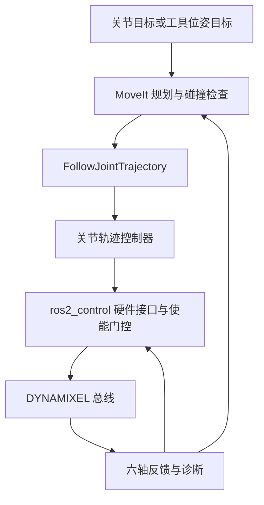

# 六轴机械臂扩展与控制系统改进设计

更新日期：2026-11-13。适用环境：Ubuntu 24.04、ROS 2 Jazzy。

本文规划在现有前三轴控制基础上，增加三个独立旋转关节，形成六轴机械臂。实施顺序为：六轴只读反馈、逐轴标定与低速控制、六轴关节轨迹、完整末端位姿规划。本文是后续设计，尚未实现六轴控制；现有三轴程序继续作为调试和回归验证入口。

## 1. 当前系统与扩展边界

| 部分 | 当前能力 | 六轴改进目标 |
| --- | --- | --- |
| `src/arm3_ros2` | 固定三个关节，当前实机使用 ID1/2/3 | 复用通信与保持逻辑，将通用控制维度改为配置驱动 |
| `kinematics.py` | 原 J4 安装点的 XYZ 正逆运动学 | 完整六轴运动链及实际工具工作点的位姿计算 |
| `dynamixel_bus.py` | 按 ID 列表同步读写，同一组控制表地址 | 按型号和总线分组，支持逐轴配置、诊断和一致的轨迹执行 |
| `node.py` | 手动使能、点动、固定起点后走 20 cm | 六轴目标校验、状态机及标准轨迹接口 |
| `src/five_dof_arm` | 独立的固定五轴实现 | 仅作为矩阵计算与旧功能参考，六轴模型须按实物重新建立 |
| `calibration/` | 当前实机配置、路径与历史反馈 | 保存测量记录；后续正式运行配置纳入 ROS 包安装 |

这里假设新增关节使用 ID4、ID5、ID6。若其中一个电机实际用于夹爪开合，则应将夹爪作为独立末端执行器建模，不能将开合自由度直接计入六轴手臂的姿态自由度。

## 2. 必须保留的使能行为

**初始使能不以应用层软件工作空间、机械运行窗口或固定起点作为准入条件。** 不因当前关节位置不在规划窗口内而拒绝原地保持，也不在使能后自动返回起点。

使能事务按以下顺序执行：

1. 读取并确认全部受控关节的当前位置、型号、运行模式和硬件状态。
2. 根据实际模式和零偏定义换算保持目标；确认目标可被舵机内部寄存器范围原值接受。
3. 在任何关节上扭矩前，写入并核对所有关节的保持目标。
4. 逐轴使能并确认回读；中途失败时，尝试撤销本次已使能或状态不确定的轴，报告撤销结果。
5. 进入 `holding`，此后接收到显式运动请求才开始运动检查。

通信错误、硬件故障、模式不匹配或保持目标回读不一致，仍属于使能失败原因。六轴驱动不能假设不同型号在断扭矩、上扭矩或重启后的编码行为完全相同。

运动请求检查与初始保持分开：运动前检查标定、当前位置、目标、整段轨迹和碰撞。当前位置超出已确认的机械运行边界时，保持可继续，普通运动及归位请求应返回具体原因；需要恢复行程时另行设计明确的维护流程，不自动生成脱困运动。

## 3. 机械模型与标定数据

实施六轴运动学前，补齐以下实测资料，禁止填写未经验证的后三轴 DH 参数或零位：

| 数据 | 记录要求 |
| --- | --- |
| 关节信息 | 关节名称、电机 ID、总线、型号和减速比 |
| 几何信息 | 六个转轴的位置与方向、相邻关节安装变换、连杆尺寸 |
| 编码标定 | 每轴零位、方向、每圈刻度及单圈/多圈模式 |
| 运动约束 | 每轴位置、速度、加速度、可用的电流/力矩约束，以及姿态相关限制 |
| 工具信息 | 法兰到工具工作点 TCP 的固定变换、工具质量与重心 |
| 结构信息 | 连杆碰撞体、底座固定方式及周围障碍物 |

现有前三轴参考数据可作为初值继续核验：零位 `[3819,989,2013]`，方向 `[1,-1,-1]`，大臂 0.24606 m、小臂 0.24225 m。方向符号描述编码到运动学角度的映射，不能只按“抬高”一词修改符号。

当前运行范围仍按 [关节限位说明](calibration/关节限位说明.md) 执行：ID1 为 0～4095、ID2 为 740～2700、ID3 为 1047～3347 刻度。ID2 文档物理上限为 3323、建议不超过 2700，完全收缩时上限为 2809；当前采用 2700 的统一运行上限。若未来放开此上限，须明确收缩状态的判据并校验耦合限制。

ID1 当前是 Mode 3 单圈位置控制。六轴扩展不会自动将其改为连续旋转关节；跨零点、线缆缠绕和多圈位置恢复需要单独设计。

## 4. 推荐的软件架构

长期架构采用 URDF/Xacro、MoveIt 2、ros2_control 和 DYNAMIXEL 硬件接口。MoveIt 的配置助手以 URDF 为输入，配置 SRDF、规划组和碰撞信息；关节轨迹控制器负责执行带时间的关节轨迹，硬件插件负责实际读写。参考 [MoveIt 配置助手](https://moveit.picknik.ai/main/doc/examples/setup_assistant/setup_assistant_tutorial.html)、[Jazzy 关节轨迹控制器](https://control.ros.org/jazzy/doc/ros2_controllers/joint_trajectory_controller/doc/userdoc.html) 和 [Jazzy 硬件组件接口](https://control.ros.org/jazzy/doc/ros2_control/hardware_interface/doc/writing_new_hardware_component.html)。MoveIt 链接为滚动文档，实施时应核对安装的 Jazzy 版本接口。



每个串口只由一个硬件驱动持有。三轴旧节点、五轴节点、六轴驱动及 Wizard 不得同时读写同一串口；调试工具通过该驱动的接口请求读写。

控制器启动、生命周期激活与电机扭矩使能保持分离。硬件接口可以只读运行；未手动使能前，不向电机执行轨迹目标。使能后先以实测位置初始化命令缓冲，并拒绝与该位置不连续的旧轨迹，防止积压命令在使能瞬间执行。

建议逐步形成以下包结构，当前提交不创建这些尚未实现的包：

```text
src/
  arm3_ros2/                 # 现有三轴调试入口与回归验证
  arm_description/           # 六轴 URDF/Xacro、网格及碰撞模型
  arm_hardware/              # DYNAMIXEL 硬件接口、状态与手动使能
  arm_moveit_config/         # SRDF、运动学、规划和控制器配置
  arm_bringup/               # 统一启动及正式实机配置
calibration/                 # 实测数据、标定来源和历史验证记录
```

## 5. 现有代码的具体改造

| 文件或模块 | 后续修改内容 |
| --- | --- |
| `arm3_ros2/node.py` | 将固定三个关节的校验、关节名称和状态数组提取为通用控制层；三轴专用固定流程单独保留 |
| `arm3_ros2/kinematics.py` | 保留三轴解析模型作回归基准；新增完整六轴模型与求解器，逐项验证两种模型的参考坐标关系 |
| `arm3_ros2/dynamixel_bus.py` | 按关节配置型号、模式、编码换算和寄存器；兼容型号分组同步读写；逐轴保存可能已使能的状态 |
| `arm3_ros2/cartesian_step.py` | 当前命令继续限定三轴；新增六轴工具位姿请求与规划结果检查，避免直接修改老命令的含义 |
| 配置与参数 | 所有数组长度与关节列表一致；型号期望值改为逐轴配置，位置、速度和加速度均带明确单位 |
| 测试与假设备 | 扩展到六轴、混合型号和部分使能失败场景；模拟模式不打开实机串口 |

同一组同步操作要求兼容的总线、协议、地址和数据长度。若后三轴寄存器布局不同，使用分组同步或批量操作；若电气接口不兼容，使用独立适配器并明确多总线时间对齐方式。不得仅按电机 ID 增加数组就假定可兼容。

控制频率根据六轴总线完整读写周期、适配器延迟和最坏通信耗时测量后确定。沿用单调时钟；总线操作超时、反馈过期或周期持续超时应取消轨迹并报告故障，不能因增加轴数而默默降低反馈质量。

## 6. 完整位姿与轨迹规划

六轴模型输出从基座到工具 TCP 的 4×4 齐次变换，目标接口使用米和归一化四元数。需要明确 `base_link`、各关节、法兰、`tool0`/TCP 与当前 `arm3_reference` 的固定变换，不能直接把当前腕部安装点坐标当作工具位置。

六轴逆解使用当前关节反馈作为种子，检查解的限位、分支连续性和正解回代误差。只有实物后三轴满足对应的几何条件时才采用位置/姿态分离解析法；不能预先假设是相交的球腕结构。

直线任务同时定义 TCP 起终点与姿态规则：固定姿态或连续姿态插值。沿途检查逆解、碰撞、关节跳变和奇异位形，并进行时间参数化，满足逐轴速度、加速度限制。首轮六轴验证采用固定工具姿态、短距离和低速度，再逐步扩大行程。

采用 `FollowJointTrajectory` 表达关节名称、时间点和轨迹状态；首次实现要求完整六轴目标，不支持含义不明确的部分轴覆盖。未知关节、缺少轴、重复关节、非有限数值或不合法时间戳均应拒绝。规划成功、轨迹被接受、实物到位需要分别报告。

当前 20 cm 路径以原腕部安装点为对象。加装腕部和工具后，移动质量、重心、碰撞体及实际 TCP 均改变，须重新验证起点、归位路径和整段运动，不能直接沿用旧运动区域确认结论。

## 7. 限位、停止与故障处理

保留三层位置约束：舵机内部寄存器范围、实物确认的机械运行边界、任务软件窗口。规划与执行使用这些约束的有效交集，运行中检查真实反馈及即将发送的目标。

回固定起点可按明确配置越过任务测试窗口，但始终遵守机械运行边界、舵机范围和已建立的碰撞约束。到位判据包含位置误差、稳定时间和阶段超时；六轴新增关节使用各自容差，不能统一假定每轴编码精度相同。

状态应区分 `read_only`、`holding`、`moving`、`stopped`、`disabled` 与 `fault`。停止取消整个活动轨迹，关闭使能清空待执行目标；故障恢复后不自动续跑。规划器与手柄请求经同一入口仲裁，禁止活动轨迹被未确认的新目标覆盖。

软件停止、断扭矩和切断驱动电源的作用不同。实现时分别明确停止/减速保持、逐轴扭矩关闭与物理急停行为；通信故障时不能以软件响应代替真实扭矩状态确认。新增腕部负载后重新核验供电、电流、承载和支撑方式。

## 8. 配置与工作空间整理

正式运行 YAML 后续放入 `arm_bringup/config/` 并通过包安装，launch 默认从包资源路径读取，也允许显式指定外部实机配置。标定测量和历史路径继续保存在 `calibration/`，每份记录注明日期、配置版本、工具版本和来源。

机械模型、运动学、硬件配置和规划器应使用同一组经校验的限位与零位。增加自动一致性检查，防止 URDF、MoveIt 和硬件驱动各自使用不同边界。历史快照不能自动覆盖当前实机配置。

本次提交仍使用既有 `calibration/arm3_horizontal_up_20cm/arm3_20cm_EXECUTE.yaml`，不移动现有文件，现有启动命令保持有效。新增正式配置时同步修改安装规则、启动文件、测试和说明，再切换默认入口。

Git 管理源码、正式配置、说明及必要测量资料；`build/`、`install/`、`log/`、开发工具配置和本地旧压缩包不提交。打包文件是对应日期快照，不作为当前源码的替代。

## 9. 分阶段实施与验收

| 阶段 | 工作 | 验收条件 |
| --- | --- | --- |
| A 只读接入 | 六轴唯一 ID、型号、模式和反馈检查 | 无自动上扭矩；状态、反馈及错误能定位到具体关节 |
| B 单轴标定 | 后三轴逐轴低速点动，补齐零位、方向和限位 | 每轴小步往返与反馈一致；使能保持和卸力结果明确 |
| C 六轴关节控制 | 六元素目标、同步执行、速度与加速度限制 | 多种初始位置均原地使能；低速轨迹、停止和超时符合预期 |
| D 模型校验 | 完整 URDF/变换链、TCP、姿态及逆解 | 多个实物姿态测量与正解对照；逆解回代、连续性和限位检查通过 |
| E 位姿规划 | MoveIt 与硬件接口联调 | 先仿真与碰撞验证，再实机短距离、固定姿态直线 |
| F 扩大测试 | 新负载下的归位、较长直线及姿态变化 | 逐步验证行程、跟踪误差、实测 TCP 轨迹及故障恢复 |

验收测试应覆盖：单个电机失联、混合型号、目标寄存器拒写、使能中途失败及回滚失败、反馈过期、越界目标和反馈、轨迹取消、控制器重启、接近奇异位形及自碰撞。自动测试使用假设备或隔离的 ROS 域，不能自行向实际机械臂发送运动。

## 10. 当前基线与下一步输入

截至本文日期，现有三轴代码已在当前工作空间完成编译并通过 70 项自动测试，包含文档限位、初始保持、归位边界和原 20 cm 模拟路径验证；这些结果不代表六轴实现或六轴实机验证已完成。此前发生的保持目标读回错误已加入重读和诊断，实际故障原因仍需对应实机响应确认。

开始六轴实现前需提供后三轴实物结构或尺寸图、逐轴型号/ID/总线、轴线与安装偏置、标定位置及限位、TCP 定义和工具负载。拿到这些数据后先完成模型与只读接入，再进入单轴调试和轨迹规划。
